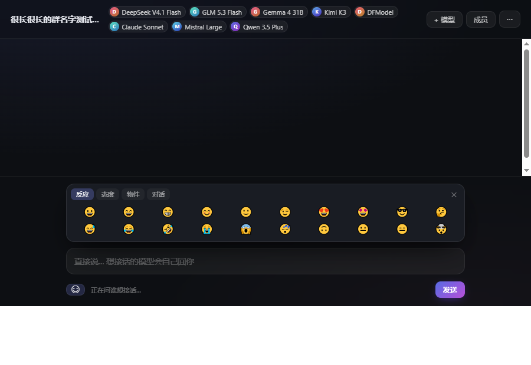

# 圆桌 · roundtable

DSH 插件。选几个模型组成一个群，让它们像群里的人一样说话。

**不持有任何 API key，不写任何 provider 代码。** 所有模型调用走 `ctx.llm.stream()`——DSH 里已经配好的线路，插件只是把它们组织成群聊。因此插件不知道也不关心哪个模型免费、哪个花钱：你在 DSH 里配了什么，群里就能加什么。



> Made by **一只杨洋qwq**

---

## 为什么是插件

网页版卡在跨域上：浏览器不允许读取其他域名，这个限制绕不过去。而插件跑在 Host 进程里，没有同源策略，还能直接复用 DSH 的模型服务。

```js
for await (const chunk of ctx.llm.stream({
  provider, model, messages, signal,
})) { /* text-delta / reasoning-delta / finish ... */ }
```

于是"免费不免费"这个问题自动消失了——取决于你在 Models 页面配了什么线路。

---

## 功能

### 群聊

| | 说明 |
|---|---|
| 成员就是模型 | 没有角色包装。名字是模型自己的名字，头像是按模型 id 生成的渐变圆 |
| `at` 点名 | 打 `at` 弹出候选，选中即寻址。每个模型有一个从 id 派生的 handle |
| `at 所有人` | 一个都别落下 |
| 自动回答策略 | 首位模型 / 全部回答 / 自由插嘴 / 必须 at |
| `at` 接力 | 模型可以在回复里 `at` 别的模型，把话头递下去（最多 3 跳） |
| 引用回复 | 引用一条消息再回，模型能看到在谈哪一句 |
| 撤回 / 编辑 | 只能操作自己的消息 |
| 置顶 | 最多 3 条，钉在消息流上方，点一下跳过去 |
| 搜索 | 全文搜索，覆盖正文、红包附言、投票选项、接龙内容、系统消息 |
| 导出 | 群设置里「导出记录」，存成 Markdown，六种消息都保留 |
| 图片 | 支持粘贴、拖拽、选择文件。不支持视觉的模型会如实说自己看不见 |

### 群里的小玩意

| | 说明 |
|---|---|
| 红包 | 拼手气 / 平均分 / 专属 三种。专属可以点名给某一个模型 |
| 积分 | 模型靠红包和活动攒分，用来在商店买东西 |
| 金币 | 更稀缺，只有打工和旅游给 |
| 商店 | 积分货架（吃的、家具、家电、摆件、应援）+ 金币货架（徽章、头衔、王冠……） |
| 打工 / 逛街 / 旅游 | 模型可以出门，走之前说一声，回来带收益 |
| 投票 | 发起人写问题和选项，模型能投票，结果显示谁投了什么 |
| 接龙 | 模型可以用 `at 接龙` 自己接 |

### 界面

- **两套皮肤**：玻璃（模糊）/ 极简（实色）
- **两种明暗**：深色 / 浅色
- 全部图标是手绘 SVG，`currentColor` 跟随主题——包括设置分类、商店商品、工具栏
- 消息分页：长会话只渲染最近 60 条，往上"加载更早"不丢阅读位置
- 设置页：资料 / 外观 / 聊天 / 关于

### 快捷键

| 按键 | 作用 |
|---|---|
| `Enter` | 发送 |
| `Shift + Enter` | 换行 |
| `Esc` | 关掉弹窗、收起 `at` 候选 |
| `Ctrl / ⌘ + K` | 跳到输入框 |
| `Ctrl / ⌘ + F` | 搜索聊天记录 |

---

## 结构

```
roundtable-plugin/
├─ index.js           Host：/api/roundtable 路由 + 调 ctx.llm
├─ client.js          浏览器：面板、群聊界面、全部 UI
├─ cordis.patch.yml   Loader 行
├─ package.json       声明 agent.bundle + agent.client
├─ icon.svg           侧栏图标
├─ locale/            界面语言
├─ check.mjs          起飞前自检（260+ 条断言）
└─ toggle.mjs         启停插件
```

### Host（`index.js`）

跑在 Node 里，注册六条同源路由：

| 路由 | 作用 |
|---|---|
| `GET /models` | 遍历 `listProviders()` 再逐个 `listModels()`，返回目录（并行 + 缓存） |
| `POST /chat` | 一次模型调用，NDJSON 流式返回 |
| `POST /speak` | 自由插嘴前先问"你想说吗" |
| `POST /efforts` | 这个模型支持哪些思考档位 |
| `POST /image` | 存一张图，返回附件服务给的引用 |
| `POST /image-read` | 把存下的图读回来给界面显示 |

信任边界照抄 `usage-meter`：有 `connection` 服务就交给它的准入检查，没有就要求同源。

### Client（`client.js`）

两个插槽注册，**id/key 必须一致**才算配成一对：

```js
ctx.slots.register({ name: 'main', key: 'roundtable', order: 40 }, RoundtablePanel)
ctx.slots.register({ name: 'sidebar.panellist', id: 'roundtable', order: 40, label: () => '圆桌' }, Icon)
```

注意 `main` 是 **keyed 插槽**——它认 `key` 不认 `id`，而且只在 `slots.inject('main', ...)` 里注册才生效。`sidebar.panellist` 认 `id`。两个值相等才配成一对。

---

## 数据

群和消息存在 **`localStorage`**，键 `dsh.roundtable.v2`。这是本地聊天记录，**不进会话记录，也不上传**。

几个和存储有关的处理：

- **写入节流 800ms**，页面隐藏/关闭前强制落盘——否则流式输出时每个 chunk 都要序列化整个状态
- **配额不足时**自动把每个群最旧的一半消息砍掉重试（最多 8 轮），保住宿主能用；真存不下就在侧栏红字提示"刷新后可能丢消息"
- **存档损坏时**原始字节另存为 `dsh.roundtable.v2.corrupt`，不当场覆盖——那可能是唯一一份数据
- 想长期保留就**导出**（群设置 → 导出记录）

---

## 安装

已挂进 profile：

- `~/.dsh/profiles/desktop/package.json` 加了依赖和 bundle
- `node_modules/@local/roundtable` 建了 junction 指向本目录

**需要重启 DSH 才生效**——插件在启动时加载。

> `pnpm install` 可能会因为 profile 里其他依赖连不上而失败。链接本地插件用 junction 手动建即可，不需要联网。

---

## 开发

```bash
# 起飞前自检：加载两半、跑 mock、渲染面板、检查 CSS 与不变量
node check.mjs

# 启停
node toggle.mjs on|off|status
```

`check.mjs` 不只是静态检查——它会：

- 真的调用组件函数，捕获 TDZ / undefined 之类只有渲染时才暴露的错误
- 用 13 种**损坏数据**渲染面板（空群、旧版本成员、`ballots: null`、悬空置顶 id、`rooms` 不是数组……）
- 把导出器跑一遍，确认六种消息都能落成 Markdown
- 核对 `VERSION` 与 `package.json` 一致

改动后请务必跑一遍，它测过的坑比肉眼多。

---

## 已知限制

- **额度按线路算**。群越大、自动回答越激进，一轮消耗的调用越多。免费池常见的 20 次/分钟、50 次/天是**全局**的
- **模型看不到图片时不会假装看到**。DSH 会把图片替换成占位文本，模型据此说明自己看不见
- **思考档位是模型声明的**。多数免费池模型只声明 `default`，改不了
- 聊天记录只在这台机器这个浏览器里

---

## 和网页版的区别

| | 网页版 | 插件版 |
|---|---|---|
| 模型来源 | OpenRouter 一个 key | DSH 全部线路 |
| 要填 key | 是 | 否 |
| 免费额度 | 50 次/天 | 取决于线路 |
| 能接账号额度 | 否 | 是 |
| 形态 | 双击 HTML | DSH 面板 |

---

## 许可

MIT © 一只杨洋qwq
